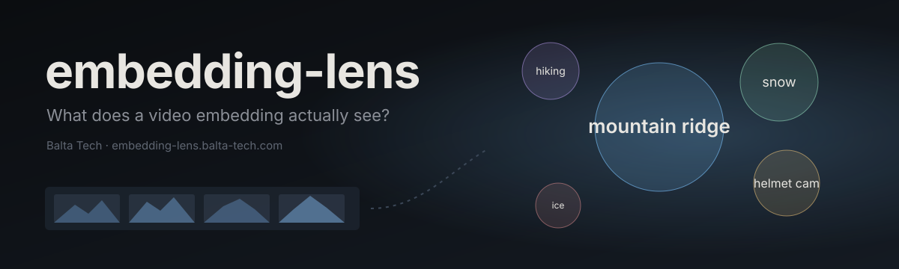

<p align="center">
  
</p>

<p align="center">
  <a href="https://embedding-lens.balta-tech.com"><b>embedding-lens.balta-tech.com</b></a> ·
  <a href="https://balta-tech.com">Balta Tech</a> ·
  <a href="docs/research.md">Research notes</a>
</p>

---

**embedding-lens** reads video embeddings back out as words. Six videos are cut into 291
five-second moments; each moment is embedded into a space shared with text, and the phrases that
land closest to it show what the model picked up. The site lets you scrub through the videos,
search them with text, and play against the model.

## How it works

```
video ─▶ frames (2 fps) ─▶ 5 s segments ─▶ segment vector ┐
                                                          ├─▶ similarity ─▶ correction ─▶ words
vocabulary (4.6k / 23k / 119k phrases) ─▶ text vectors ───┘
```

| Model | Video input | Vector |
| --- | --- | --- |
| [Qwen3-VL-Embedding 2B](https://huggingface.co/Qwen/Qwen3-VL-Embedding-2B) | frames as a sequence | 2048 |
| [EmbeddingGemma 2](https://huggingface.co/google/embeddinggemma-2) | mp4 clip | 768 |
| [SigLIP 2 base](https://huggingface.co/google/siglip2-base-patch16-256) | frames averaged (baseline) | 768 |

Read-outs: **raw** cosine, **centred** (each modality's mean removed, closing the modality gap), a
**sparse** non-negative decomposition, and a **change** read-out of the difference between two
consecutive moments. Hub corrections (CSLS, priors, z-scores, null videos) are implemented and
measured too. Which read-out to trust depends on the model; the [experiments](experiments/)
decide it, partly by judging read-outs against the frames
([`judgements.json`](experiments/judgements.json)).

## Repository

```
lens/          pipeline: videos, vocabularies, models, index, read-out, export, API
experiments/   mini experiments behind every default; results land in data/results/
web/           the site (Vite, plain JS, d3); web/public/data is generated by lens.export
docs/          research notes and banner
```

## Run it

Requires [uv](https://docs.astral.sh/uv/), Node 22+ and ffmpeg. About 7 GB of models and 1.5 hours of
embedding on an Apple M3 Pro.

```bash
uv sync
uv run python -m lens.videos all                    # download videos, extract frames
uv run python -m lens.index siglip2 gemma2 qwen3vl  # embed segments and vocabularies
uv run python -m lens.export                        # write web/public/data
npm install && npm run dev                          # http://localhost:5173
```

Live features (free-text search, scoring any word in the game) need the API. The deployed site calls
`https://embedded-lens-api.balta-tech.com`; `npm run dev` proxies `/api` to `localhost:8000`:

```bash
uv run uvicorn lens.api:app --port 8000
```

To point the deployed site at your own backend, set `localStorage["embedding-lens:api"]` (for example
to `http://localhost:8000`) and reload.

Experiments: `scripts/run_experiments.sh` (all, several hours) or
`scripts/run_experiments.sh geometry sim_real` (some). Tests: `uv run pytest`.

## Deploy

Static build served by the `embedding-lens` Cloudflare Worker; the API runs separately behind `embedded-lens-api.balta-tech.com` ([`wrangler.jsonc`](wrangler.jsonc)).
Every push to `main` runs [`deploy.yml`](.github/workflows/deploy.yml): `npm ci`, `npm run build`,
`wrangler deploy`. Requires the repository secret `CLOUDFLARE_API_TOKEN`. The generated site data
in `web/public/data` and `web/public/media` is committed, so CI does not need the models.

## Credits

Videos from [@rbalazs](https://www.youtube.com/@rbalazs), downloaded locally and never committed.
Vocabularies from [RAM++](https://github.com/xinyu1205/recognize-anything), ImageNet-21k via
[timm](https://github.com/huggingface/pytorch-image-models), [Places365](https://github.com/CSAILVision/places365),
[Kinetics](https://github.com/deepmind/kinetics-i3d) and [WordNet](https://wordnet.princeton.edu/).
Built by [Balta Tech](https://balta-tech.com).
